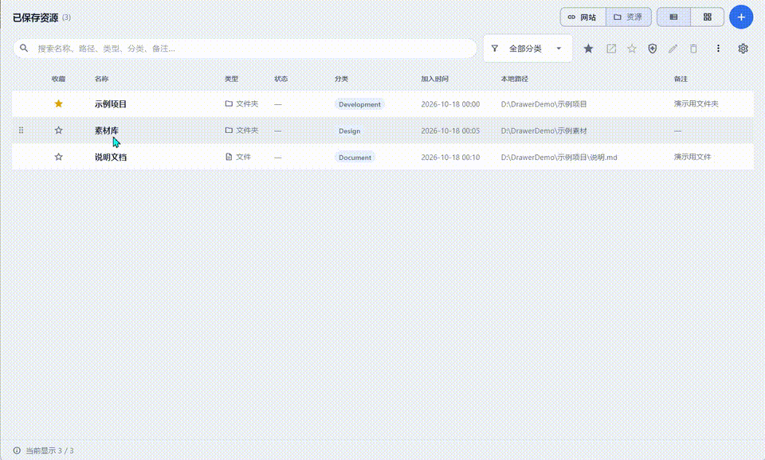
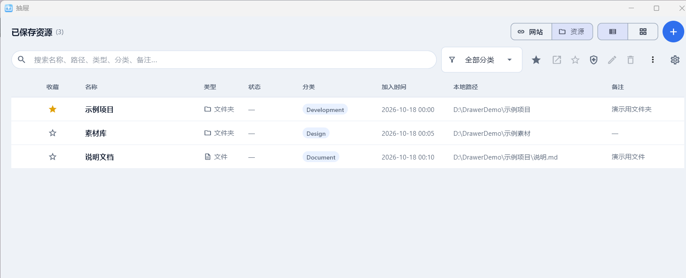
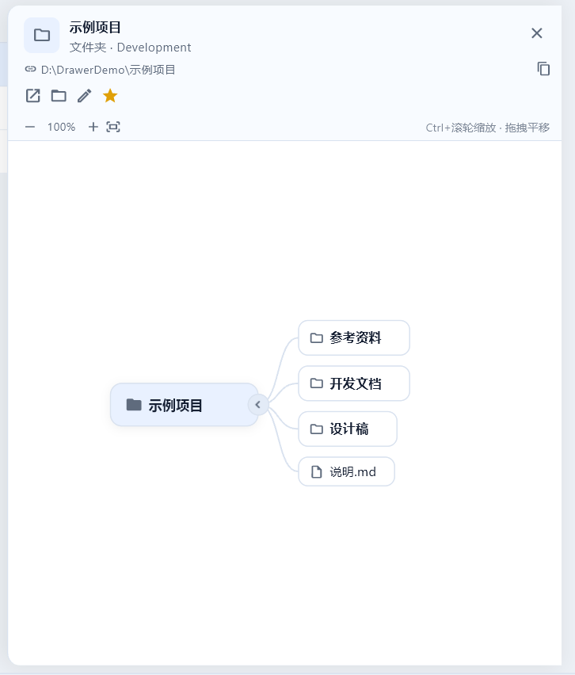
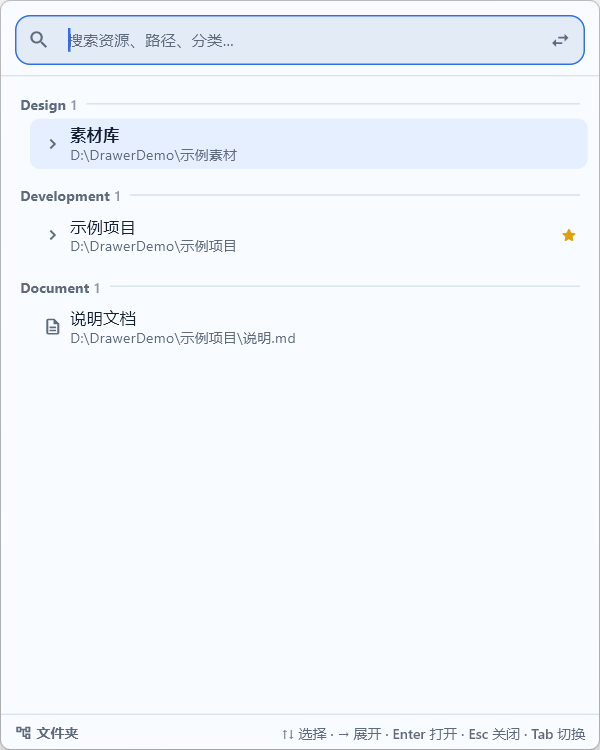
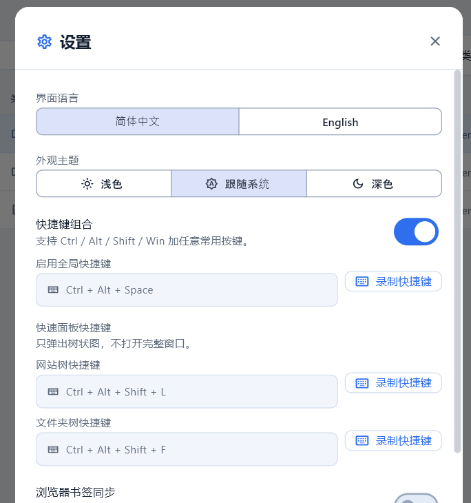

# 抽屉 Drawer

[English](README.md) · [简体中文](README.zh-CN.md)

<p align="center">
  
</p>

<p align="center">
  <b>把每天要打开的网址、文件夹和文件，都收进一个抽屉。</b><br>
  一个快捷键，敲几个字，回车即开。
</p>

<p align="center">
  <a href="https://github.com/hsq2004815-oss/resource-hub-desktop/releases/latest"></a>
  
  
  
  
</p>

<p align="center">
  <a href="https://github.com/hsq2004815-oss/resource-hub-desktop/releases/latest"></a>
</p>

**免安装绿色版，约 22 MB。** 解压整个文件夹，双击 `resource_hub.exe` 就能用——不用装 Python，不用注册账号。

## 它解决什么问题？

每天要用的东西，Windows 把它们分散在好几个地方：网址在浏览器书签里，常用文件夹在资源管理器
的「快速访问」里，文件在桌面或某个深层目录里。抽屉把它们收进一个可搜索的列表，并且永远只隔一个
快捷键。

- **网址、文件夹、文件，一个列表。** 同一个搜索框，同一套键盘操作，图标不同而已。
- **不用打开资源管理器就能看文件夹。** 点一下文件夹，内容直接展开成思维导图，可以缩放、拖动、逐层展开。
- **是面板，不是窗口。** `Ctrl + Alt + Shift + L` / `F` 在屏幕中间弹出一个紧凑的树状面板，输入、方向键、回车，随即消失。
- **数据不出本机。** 不登录、不联网、无统计，所有数据就是程序目录里的几个 JSON 文件。

## 截图

<p align="center">
  <br>
  <sub><b>主窗口</b> —— 网站、文件夹、文件放在同一个列表里；列表 / 网格切换，拖动排序，收藏置顶。</sub>
</p>

<p align="center">
  <br>
  <sub><b>文件夹思维导图</b> —— 点击文件夹行即可展开内容；Ctrl+滚轮缩放、拖动平移、逐层展开；双击打开，右键加入抽屉。</sub>
</p>

<table>
<tr>
<td width="50%" align="center" valign="top">
  <br>
  <sub><b>快速面板</b> —— <code>Ctrl+Alt+Shift+L/F</code> 呼出的紧凑树状列表。</sub>
</td>
<td width="50%" align="center" valign="top">
  <br>
  <sub><b>设置</b> —— 语言、主题、快捷键、书签同步、AI 分类建议。</sub>
</td>
</tr>
</table>

## 功能

**资源管理**

- 两种资源：网站，以及本地路径（文件夹或单个文件）。
- 按名称、路径、类型、分类、备注搜索；按分类筛选。
- 收藏置顶；列表和网格视图下都可以拖动排序，误拖了有 5 秒撤销。
- 支持从资源管理器把文件 / 文件夹直接拖进窗口添加；JSON 导入导出备份（兼容旧版 Python 数据）。

**快速面板**

- 不打开完整窗口，在屏幕中央弹出一个 Spotlight 风格的紧凑树状列表。
- `Ctrl + Alt + Shift + L` 网站树；`Ctrl + Alt + Shift + F` 文件夹树（都可以在设置里改）。
- `↑` / `↓` 选择，`→` 展开，`Enter` 打开，`Esc` 关闭，`Tab` 切换面板；直接输入即搜索。

**文件夹思维导图**

- 详情面板把文件夹内容自动排成思维导图，省掉一层层点开资源管理器的过程。
- `Ctrl` + 滚轮缩放，拖动平移，单击恢复 100%。
- 双击节点直接打开；右键把子项加入抽屉。

**系统集成**

- Chrome / Edge 书签同步：自动读取本地书签文件（只读）导入新书签；随应用附带的 MV3 扩展可选支持双向删除 / 改名同步。
- 资源管理器右键菜单：在文件夹空白处或文件夹图标上右键 → **添加到抽屉**（Windows 11 在「显示更多选项」里）；可以在设置中关闭。
- 托盘图标、关闭到托盘、可选开机启动；全局快捷键支持 `Ctrl / Alt / Shift / Win` 任意组合。

**可选的 AI 分类建议**（实验功能，默认关闭）

- 用 DeepSeek 或任意 OpenAI 兼容接口，给未分类的资源推荐分类。
- 推荐结果要你确认后才会写入；API Key 用 Windows DPAPI 加密保存，不会进入仓库。

**细节**

- 路径体检：失效路径会被标出来；一键在资源管理器打开或定位。
- 中文 / 英文界面，浅色 / 深色 / 跟随系统主题。
- 完全本地运行，无账号、无遥测。

## 下载安装

1. 到 [Releases](https://github.com/hsq2004815-oss/resource-hub-desktop/releases/latest) 下载 `Drawer-v*-win64.zip`。
2. 把**整个文件夹**解压到可写目录（例如 `D:\抽屉`），不要只拷 exe，也不要放在 `Program Files`。
3. 双击 `resource_hub.exe`。SmartScreen 提示时点「更多信息 → 仍要运行」——exe 没有代码签名，这是正常的。
4. 首次启动会生成几条示例资源，可以直接删掉，换成自己的。

系统要求：Windows 10 / 11，64 位。数据就存在程序目录（`sites.json`、`folders.json`、`settings.json`），
备份或换电脑直接复制整个文件夹即可；卸载就是删除文件夹。

## 快捷键

| 快捷键 | 作用 |
|---|---|
| `Ctrl + Alt + Space` | 显示 / 隐藏主窗口 |
| `Ctrl + Alt + Shift + L` | 快速面板：网站 |
| `Ctrl + Alt + Shift + F` | 快速面板：文件夹 |
| `↑` `↓` / `→` / `Enter` / `Esc` / `Tab` | 选择 / 展开 / 打开 / 关闭 / 切换面板 |

所有快捷键都可以在**设置 → 快捷键**里重新录制，支持 `Ctrl / Alt / Shift / Win` 组合。

## 常见问题

**收费吗？** 不收费，MIT 协议，可以自由使用、修改、分发。

**会上传我的数据吗？** 不会。唯一的网络请求来自可选的 AI 分类建议，用的是你自己配置的接口和 API Key。

**为什么 Windows 提示不安全？** exe 没有买代码签名证书（个人开源项目）。完整源码就在这个仓库里，也可以自己编译。

**和 PowerToys Run / Everything 有什么区别？** 那两个是搜索已安装程序或全盘索引；抽屉管理的是你**主动收藏**的那一小批网址、文件夹和文件，而且能不开资源管理器直接看文件夹结构。

**换电脑怎么办？** 复制整个程序文件夹即可，数据一起带走。

**支持 Mac / Linux 吗？** 目前只支持 Windows。

## 使用说明

随应用附带中文使用手册，仓库里也有一份：
[抽屉使用说明.docx](docs/抽屉使用说明.docx) ·
[PDF](docs/抽屉使用说明.pdf)。

内容覆盖安装、添加资源、文件夹思维导图、快速面板快捷键、浏览器书签同步、右键菜单、AI 分类建议、
数据与备份、常见问题排查。

版本更新见 [CHANGELOG.md](CHANGELOG.md)（从 `v0.1.0` 到 `v1.0.5`）。

## 从源码构建

构建产物**不提交**（`release/` 已被 git 忽略），需要在本机打包：

环境要求：

- Flutter 3.47+（带 Windows desktop 支持）
- Visual Studio 2022 Build Tools（Desktop development with C++）
- Python 3.11+ 和 PyInstaller（用于打包后端）

```powershell
# 先把脚本顶部的 $python 和 $flutterRoot 改成自己机器上的路径
powershell -NoProfile -ExecutionPolicy Bypass -File .\build-flutter-release.ps1
```

输出目录：`release\ResourceHub-Desktop-<时间戳>\`，双击 `resource_hub.exe` 启动。目录必须可写——
数据文件就存在 exe 旁边。

## 从源码运行

启动 Flutter 客户端，它会自动找到并拉起 Python 后端：

```powershell
cd app
flutter run -d windows
```

如果 Python 不在 `PATH` 里，用 `RH_PYTHON` 指向解释器。也可以手动启动后端：

```powershell
python backend\main.py [数据目录]
```

客户端支持的环境变量：`RH_PYTHON`、`RH_BACKEND_SCRIPT`、`RH_BACKEND_EXE`、`RH_DATA_DIR`。

## 测试

```powershell
cd app
flutter test                                  # 75 个测试：组件、协议、JSON

cd backend
python -m unittest discover -s tests -t .     # 326 个测试（跳过 1 个：符号链接）
```

Flutter 客户端 + Python 后端合计 400 个通过的测试。

## 这个项目是怎么来的

仓库里是两代实现：

| 路径 | 作用 |
|---|---|
| `app/` + `backend/` | **当前版本**：Flutter Windows 客户端（约 1.2 万行 Dart）+ 无界面 Python 后端（约 7900 行，纯标准库），通过 stdio 上的 JSON Lines 通信 |
| `resource_hub.pyw` | 旧版单文件 Tkinter 应用（约 2900 行），保留作参考和回滚，不再开发 |

从 Tkinter 到 Flutter + Python 的迁移按阶段记录在 [`migration/`](migration/) 里：审计、设计系统、
业务层、IPC 协议、打包、Shell 集成，以及 25 篇 UI / 功能阶段文档。它也可以当作一个「把单体 Tkinter
应用拆成 UI + 可测试后端，并且**不改用户数据格式**」的完整案例——旧的 `sites.json` / `folders.json`
可以直接用。

## 项目结构

```
app/                      Flutter 客户端（lib/ 源码，windows/ 原生外壳）
backend/                  Python 业务层 + JSON Lines 协议服务
docs/                     使用手册（docx/pdf）和截图
migration/                迁移记录：审计、设计系统、ADR、协议、Shell 集成、打包、UI 重构、截图
resource_hub.pyw          旧版 Tkinter 实现（仅参考）
build-flutter-release.ps1 打包脚本（Flutter 客户端 + 冻结后端）
release/                  构建输出（git 忽略）
```

## 数据文件

运行时应用在 exe 旁边（从源码运行时在仓库根目录）读写：

- `sites.json` —— 网站收藏
- `folders.json` —— 文件夹 / 文件收藏
- `settings.json` —— 语言、主题、全局快捷键、开机启动

这些文件已被 git 忽略。示例数据在 `sites.sample.json` 和 `folders.sample.json`；格式和旧版
Python 版本完全一致，旧数据可以直接迁移。

## 说明

- 拖入文件夹只保存这个文件夹路径，不会导入里面的内容。
- 拖入文件只保存这个文件路径。
- 关闭窗口是隐藏到托盘——要退出请用托盘菜单。

## 参与贡献

欢迎提 Issue 和 PR。如果抽屉帮你每天少点几下，点一个 ⭐ 能让更多人看到它。

## 许可证

MIT 协议，Copyright (c) 2026 黄双全 (Huang Shuangquan)。

可以自由使用、复制、修改、分发和商用，保留版权声明即可。完整文本见 [LICENSE](LICENSE)。
